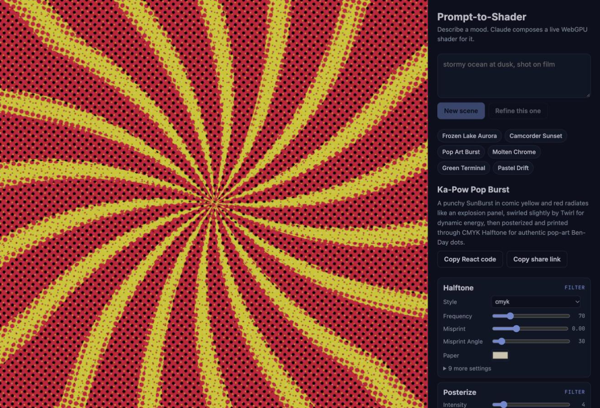
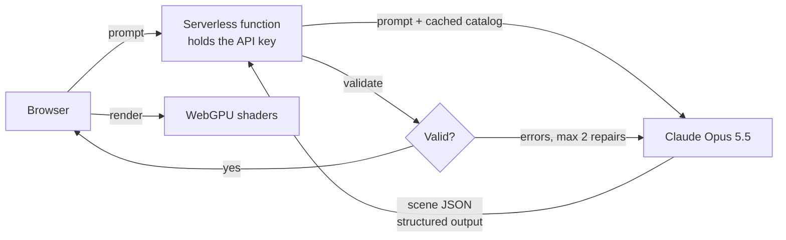

# Prompt-to-Shader

Describe a mood in plain words and Claude composes a live, animated WebGPU shader for it.

**[Try it live → prompt-to-shader.vercel.app](https://prompt-to-shader.vercel.app/)** (needs a WebGPU browser: recent Chrome, Edge, or Safari)



*Above: Claude's answer to "a comic-book explosion of color, pop art". A yellow-on-red sunburst, twirled, posterized, then printed through a CMYK halftone.*

## What it does

- **Type a prompt** like "stormy ocean at dusk, shot on film" and get a layered, moving scene in about 10 seconds.
- **Refine it** in conversation ("make it colder", "less grain") and Claude edits the current scene instead of starting over.
- **Tweak by hand.** Every layer gets sliders and color pickers, generated from the shader library's own metadata.
- **Take it with you.** Copy the scene as ready-to-paste React code, or copy a share link that holds the whole scene in the URL.

## How it works



1. **The model writes data, not code.** Claude fills in a strict scene format: a bottom-to-top stack of up to 6 layers, each a shader name plus settings. Structured outputs guarantee the shape.
2. **The format is generated, not hand-written.** The list of ~70 shaders and every setting's type and range come from the [`shaders`](https://shaders.com) library's registry, so the prompt can't drift from what the renderer supports.
3. **Code checks meaning; the model fixes real mistakes.** A validator clamps out-of-range numbers and drops unknown settings silently, and sends genuine errors (like a filter placed at the bottom with nothing to filter) back to Claude to repair, at most twice.
4. **The key never reaches the browser.** A serverless proxy holds it, validates input, and rate-limits each visitor.

### A bug worth mentioning

Some shaders ship default color "stops" that silently override `colorA`/`colorB`. The model would pick a palette, and the scene would render in the defaults with no error anywhere. The validator detects this from the registry metadata and promotes the chosen colors to stops, for every shader with that pattern.

## Numbers from real runs

| | |
|---|---|
| Latency | 5–11 s per scene (local and production) |
| Cost, cold cache | ~7.5¢ (writes the 12.5k-token catalog to cache) |
| Cost, warm cache | ~2¢ (catalog read from cache at a tenth of the price) |
| First-try valid | 8 of 8 early runs, 0 repairs needed |

Validity isn't quality: one early scene ("neon tokyo alley in the rain") passed every check but its rain read as squiggles. An eval set that scores quality, not just validity, is the next piece of work.

## Run it locally

Requires Node 20+ and a browser with WebGPU (recent Chrome, Edge, or Safari).

```bash
npm install
echo "ANTHROPIC_API_KEY=your-key" > .env.local   # never commit this file
npm run dev
```

Without a key, the app still runs with six starter scenes.

Other commands:

```bash
npm test                     # validator unit tests
npx tsx --env-file=.env.local scripts/generate.mts "your prompt"   # one scene from the CLI
```

## Project layout

| Path | What's there |
|---|---|
| `src/scene/catalog.ts` | Builds the model-facing shader catalog from the library registry |
| `src/scene/schema.ts` | Scene format, validator, and conversions |
| `server/generateScene.ts` | Claude call, prompt caching, repair loop |
| `server/handler.ts`, `api/generate.ts` | Serverless endpoint: input checks, rate limit, streamed progress |
| `src/Studio.tsx`, `src/PropsPanel.tsx` | The app UI and auto-generated controls |

Built with React, Vite, TypeScript, the Anthropic SDK, and [shaders](https://shaders.com).
